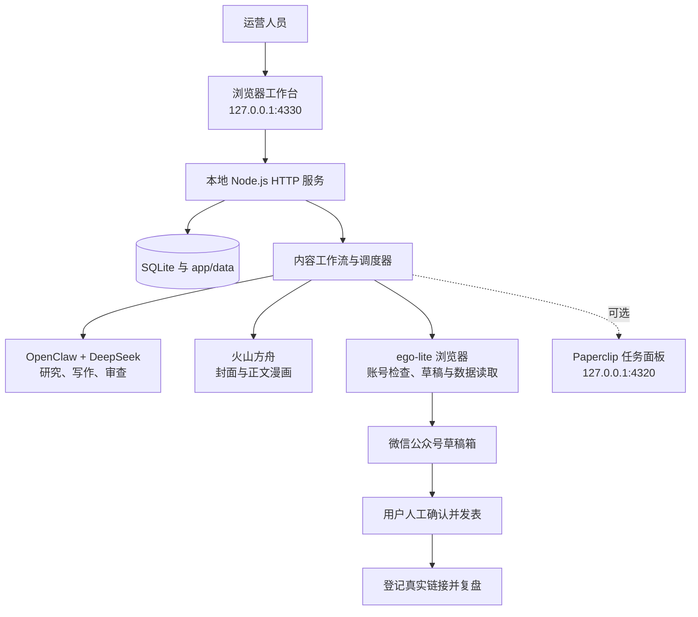

# 微光内容运营工作台

微光内容运营工作台是一个可在 Windows、macOS 和 Linux 本机运行的小程序内容运营工具。它把产品资料整理、公开内容研究、多平台写稿、事实审查、漫画配图、人工审核、微信公众号草稿上传和发布后复盘放在同一个工作台中。

项目使用原生 **Node.js HTTP + SQLite + 浏览器 JavaScript**，不需要前端编译。写作和审查通过 OpenClaw 隔离角色调用 DeepSeek，图片由火山方舟生成，平台操作通过本机浏览器完成；Paperclip 可作为独立的任务管理面板接入。

系统坚持两个边界：服务只绑定本机地址，不直接自动发表内容。微信公众号稿件只上传到草稿箱，最终发表必须由用户在平台后台完成。

[项目亮点](#项目亮点) · [核心功能](#核心功能) · [技术组成](#技术组成) · [整体流程](#整体流程) · [快速开始](#快速开始) · [项目目录](#项目目录) · [运维与文档](#运维与文档)

阅读顺序：先看项目亮点和核心功能了解用途，再看技术组成与整体流程；准备使用时从快速开始和使用顺序开始，开发维护时查项目目录、开发验证及运维文档。

## 项目亮点

### 1. 从产品资料到多平台稿件集中处理

可以维护小程序定位、受众、功能限制、禁止说法、资料文档、二维码和页面截图。创建内容任务后，系统基于已确认资料完成选题研究，并分别生成微信公众号、今日头条和小红书稿件。

### 2. 写作、审查和修改由不同角色完成

写作结果不会直接进入发布环节。系统使用隔离角色完成内容生成、事实审查和按意见修改，区分已验证事实、搜索摘要和不能确认的内容，降低夸大表述和平台错配风险。

### 3. 付费调用有额度和结果保护

每个任务设置模型调用上限，并记录调用角色、阶段、状态和用量。网络中断和可恢复错误可以按限制重试；付费请求结果不明时停止自动重试，避免重复生成和重复扣费。

### 4. 配图与产品素材跟随稿件管理

系统调用火山方舟分别生成漫画封面和无文字正文插图，也能按文章场景选用已登记的二维码和产品页面截图。图片与稿件版本绑定，可用于预览、离线导出和微信公众号草稿。

### 5. 微信只传草稿，最终发表由人工确认

审核通过后，微信公众号内容可以上传到草稿箱，但程序不会点击最终发表。今日头条和小红书稿件保留导出与手工处理方式，避免把自动化结果误认为真实发布结果。

### 6. 发表后再开始效果复盘

草稿上传成功不等于文章已经发表。用户登记真实文章链接后，系统才记录发表结果，并按计划收集阅读、互动及小程序访问数据。

### 7. 任务可恢复，可选接入 Paperclip

任务阶段、稿件、审批、调用记录和外部回执会写入本地数据库。程序重启后可以从已完成阶段继续；Paperclip 可用于查看和分配待办，但它不可用时不影响主工作台独立运行。

## 核心功能

| 功能 | 说明 |
| --- | --- |
| 产品资料管理 | 维护产品定位、受众、功能边界、资料文档、二维码和页面截图 |
| 公开内容研究 | 收集近期中文文章线索，区分已验证事实、搜索摘要和未知信息 |
| 多平台写稿 | 分别生成微信公众号、今日头条和小红书内容，不用一份稿件直接复用所有平台 |
| 独立内容审查 | 检查事实依据、夸大说法、平台适配和产品能力边界，并保留修改记录 |
| 漫画配图 | 调用火山方舟生成封面和正文插图，校验结果并按内容缓存复用 |
| 人工审核 | 查看正文、配图和审查意见，支持手动修改、退回修改和版本确认 |
| 微信草稿上传 | 将已确认内容保存到微信公众号草稿箱，不执行最终发表 |
| 手工交付 | 为今日头条和小红书导出内容，由用户在对应平台完成发布 |
| 周期任务 | 按产品、平台、间隔和调用上限创建下一期内容任务 |
| 发布后复盘 | 登记真实文章链接后，按计划收集平台互动和小程序访问数据 |
| 账号状态检查 | 检查平台登录状态，读取授权范围内的后台可见信息 |
| 调用与费用记录 | 记录模型调用阶段、状态、上游标识、耗时和用量，不保存密钥或请求正文 |

例如，运营人员先确认产品资料，再创建微信公众号内容任务。系统检索近期公开线索，生成稿件并由独立角色审查，随后生成漫画封面和正文插图。运营人员确认内容后上传到公众号草稿箱，手工发表并登记真实链接，系统才开始安排后续数据复盘。

## 技术组成

| 层次 | 技术与职责 |
| --- | --- |
| 浏览器工作台 | 原生 HTML、CSS 和 JavaScript；管理产品、任务、稿件、素材、审核、账号和运行设置 |
| 本地 HTTP 服务 | 原生 Node.js HTTP；提供静态页面和 `/api/*` 接口，组合存储、模型、浏览器和调度组件 |
| 业务数据 | SQLite；保存产品、文档、任务、稿件、审批、账号、效果数据和事件 |
| 内容工作流 | 持久化状态机；控制研究、写作、审查、配图、审核、草稿上传和恢复 |
| 模型执行 | OpenClaw 隔离角色 + DeepSeek；执行研究整理、写作、审查和修改 |
| 图片生成 | 火山方舟图片接口；生成漫画封面和正文插图，并校验响应与图片 |
| 平台操作 | ego-lite 浏览器控制；检查账号状态、填写微信编辑器、保存草稿和只读采集数据 |
| 任务调度 | 本地调度器；创建周期内容任务和发表后的 24/48/72 小时数据任务 |
| 可选任务面板 | Paperclip；镜像工作台任务，并导入分配给运营负责人的待办 |
| 文档处理 | `markdown-it`、`fflate`、`fast-xml-parser`；渲染 Markdown，读取并校验 DOCX |

## 整体流程

系统由本机浏览器、本地服务、业务数据和外部能力组成：



一项典型内容任务按以下顺序执行：

1. 选择已确认的产品资料、目标平台和模型调用上限。
2. 根据产品资料、历史内容和公开来源确定选题方向。
3. 为微信公众号、今日头条和小红书分别生成稿件。
4. 由独立角色检查事实、夸大表述、平台适配和产品边界。
5. 生成封面与正文漫画，组合产品二维码和页面截图。
6. 等待用户修改、退回或确认当前版本。
7. 微信稿件上传草稿箱；其他平台导出后由用户手工处理。
8. 用户登记真实发表链接后，再安排发布后数据收集。

已完成阶段会持久化。普通网络错误可以在限定次数内重试；付费调用、草稿保存等操作如果结果不明，会保留现场并等待人工核实。

## 数据存储

| 数据 | 位置 | 用途 |
| --- | --- | --- |
| 业务对象 | `app/data/operator.sqlite` | 产品、任务、稿件、审批、账号、效果和事件的主要数据源 |
| 图片与导出文件 | `app/data/assets/` | 保存产品素材、生成图片和稿件相关文件 |
| 外部服务配置 | `.env` | DeepSeek、火山方舟、端口和默认调用预算的唯一配置来源，不提交 Git |
| 模型调用账本 | `app/data/runtime/` | 调用额度、费用保护和异常恢复依据 |
| Paperclip 数据 | `research/runtime-lab/state/paperclip/` | Paperclip 的数据库、配置和本地密钥 |
| 旧版归档 | `archive/legacy-operator/` | 迁移旧配置和人工追溯，不作为当前业务数据库 |

`app/data/`、Paperclip 状态、产品配置、原始材料和旧版归档都可能包含真实业务数据或凭证，不应提交到 Git，也不能当作普通缓存删除。

## 快速开始

### 环境要求

- Windows 10/11、macOS 或常见 Linux 发行版；
- Windows 使用 PowerShell；macOS/Linux 使用 Bash；
- Node.js 22.19.0 或更高版本，推荐 Node.js 24；
- 可访问 npm registry，用于首次安装依赖；
- 需要生成内容时，准备可用的 DeepSeek 和火山方舟凭证；
- 需要操作平台时，另行安装 `ego-browser`，并由用户本人完成登录。

### 首次安装

克隆仓库后，在根目录执行：

Windows PowerShell：

```powershell
./Setup.ps1
```

macOS/Linux：

```bash
bash ./setup.sh
```

脚本会安装主程序依赖和固定版本的 OpenClaw，并在不存在时把 `.env.example` 复制为 `.env`。真实密钥只填写到 `.env`，该文件已被 Git 忽略。

编辑根目录 `.env`，至少填写：

```dotenv
DEEPSEEK_API_KEY=你的DeepSeekKey
ARK_API_KEY=你的火山方舟Key
```

### 启动主工作台

在仓库根目录执行：

Windows PowerShell：

```powershell
./Start.ps1
```

macOS/Linux：

```bash
bash ./start.sh
```

浏览器打开 <http://127.0.0.1:4330>。看到“微光 · 内容运营工作台”表示服务已经启动。

如果 4330 端口已被占用，不要立即重复启动；先访问该地址，确认是否已有工作台实例在运行。关闭启动窗口或按 `Ctrl+C` 会停止服务，已写入数据库的记录会保留。

### 启动可选任务面板

需要 Paperclip 时，Windows 执行 `./Setup.ps1 -IncludePaperclip`，macOS/Linux 执行 `bash ./setup.sh --paperclip`。安装后按 [Paperclip 说明](research/runtime-lab/README.md)准备本地配置，再另开一个终端启动：

```powershell
./research/runtime-lab/Start-Lab.ps1
```

```bash
bash ./research/runtime-lab/start-lab.sh
```

面板地址为 <http://127.0.0.1:4320>。Paperclip 未启动不代表主工作台故障。

## 统一配置

根目录 `.env` 是安装与外部服务参数的唯一入口。“运行设置”页面只显示非敏感配置摘要并测试连接，不保存或回显 API Key。修改 `.env` 后需要重启工作台。

| 参数 | 默认值 | 说明 |
| --- | --- | --- |
| `APP_PORT` | `4330` | 主工作台监听端口 |
| `APP_DATA_DIR` | `app/data` | 数据目录，相对路径按仓库根目录解析 |
| `DEFAULT_MAX_CALLS` | `12` | 新建任务默认的文字模型调用上限 |
| `DEEPSEEK_API_KEY` | 空 | 文字模型密钥；研究、写作和审查时必需 |
| `DEEPSEEK_MODEL` | `deepseek-flash` | DeepSeek 或兼容服务中的模型名称 |
| `DEEPSEEK_BASE_URL` | `https://api.deepseek.com` | OpenAI 兼容服务基础地址，不包含 `/chat/completions` |
| `ARK_API_KEY` | 空 | 火山方舟图片 API Key；也兼容 `VOLCENGINE_API_KEY` |
| `ARK_IMAGE_MODEL` | `doubao-seedream-5-0-flash-260915` | 图片模型名称或 `ep-` 接入点 ID |
| `OPENCLAW_PATH` | `app/node_modules/openclaw/openclaw.mjs` | OpenClaw 执行文件，相对路径按仓库根目录解析 |
| `EGO_BROWSER_COMMAND` | `ego-browser` | 可选浏览器控制命令；缺少时仅影响平台账号操作 |
| `PAPERCLIP_ENABLED` | `false` | 是否连接可选 Paperclip 面板 |
| `PAPERCLIP_BASE_URL` | `http://127.0.0.1:4320/api` | Paperclip API 地址 |
| `PAPERCLIP_PORT` | `4320` | Paperclip 本地面板端口 |
| `PAPERCLIP_CONFIG` | `research/runtime-lab/state/paperclip/instances/default/config.json` | Paperclip 本地配置文件 |

`.env` 修改后需要重启工作台。DeepSeek 地址和模型、火山图片模型、数据目录及端口都会在下次启动时生效。

## 使用顺序

1. **确认产品资料**：填写产品名称、AppID 和入口路径，上传 DOCX、TXT 或 Markdown 文档，检查受众、可用功能和禁止说法后确认版本。
2. **准备发布账号**：添加公众号、头条或小红书账号，由本人在浏览器中登录，再通过工作台检查状态。
3. **新建内容任务**：选择产品、目标平台和调用上限；系统依次完成选题、研究、分平台写稿、审查和配图。
4. **审核并交付**：查看正文、审查意见和配图，修改或确认版本；微信公众号只上传草稿，其他平台导出后手工发布。
5. **登记真实发表结果**：在平台完成发表后，回到工作台登记真实文章链接。
6. **查看效果复盘**：根据已登记链接收集阅读、互动及小程序访问数据，查看后续内容方向。
7. **按需启用周期任务**：设置产品、平台、间隔天数和调用上限；程序需要保持运行，关闭后不会在后台执行。

更完整的业务操作、配置和限制见[工作台使用说明](app/README.md)。

## 项目目录

```text
WeixinMp/
├── Setup.ps1                       # 首次安装依赖并创建本地配置
├── Start.ps1                       # 加载根目录 .env 并启动主工作台
├── setup.sh                        # macOS/Linux 首次安装脚本
├── start.sh                        # macOS/Linux 主工作台启动脚本
├── .env.example                    # 统一配置模板，不含真实密钥
├── app/                            # 当前内容运营工作台主程序
│   ├── Start.ps1                   # 主工作台启动脚本
│   ├── start.sh                    # macOS/Linux 启动入口
│   ├── package.json                # 项目依赖和测试命令
│   ├── public/                     # 浏览器页面、样式和交互脚本
│   ├── src/                        # 本地服务、业务工作流和平台操作代码
│   │   ├── server.mjs              # HTTP 入口和组件组合
│   │   ├── workflow.mjs            # 内容任务状态机与断点续跑
│   │   ├── store.mjs               # SQLite 数据存储与并发保护
│   │   ├── agent-runtime.mjs       # 模型调用、额度控制、重试和调用记录
│   │   ├── content-tools.mjs       # 文档导入、Markdown 渲染和稿件资源组合
│   │   ├── cover-agent.mjs         # 火山方舟图片生成与结果校验
│   │   ├── browser*.mjs            # 平台浏览器连接、识别和只读操作
│   │   ├── wechat-*.mjs            # 微信编辑器确认和草稿保存
│   │   └── scheduler.mjs           # 周期内容和发布后数据任务
│   ├── tests/                      # Node.js 自动化测试
│   ├── data/                       # 业务数据库、图片、凭证和运行记录
│   └── node_modules/               # 已安装的主程序依赖
├── research/
│   └── runtime-lab/                # 可选的 Paperclip 本地任务面板
│       ├── Start-Lab.ps1           # Paperclip 启动脚本
│       ├── start-lab.sh            # macOS/Linux Paperclip 启动脚本
│       ├── start-lab.mjs           # 加载统一配置并启动 Paperclip
│       ├── config/                 # 旧环境配置的首次导入来源
│       ├── materials/              # 旧环境产品资料的首次导入来源
│       ├── state/paperclip/        # Paperclip 数据库、配置和本地密钥
│       └── node_modules/           # Paperclip 程序和依赖
├── archive/
│   └── legacy-operator/            # 旧版业务数据归档，用于迁移和追溯
├── operator/                       # 旧版工作目录遗留数据，不是当前程序入口
├── docs/
│   ├── architecture.md             # 系统架构、流程、存储和安全边界
│   ├── development.md              # 开发环境、源码导航和测试约定
│   └── operations.md               # 启停、备份、凭证和故障排查
├── .gitignore                      # 仓库级 Git 忽略规则
└── README.md                       # 项目入口说明
```

## 开发验证

项目使用原生 Node.js HTTP、SQLite 和浏览器 JavaScript，没有前端构建步骤。依赖未安装时，在 `app/` 目录执行 `npm ci`（Windows 也可使用 `npm.cmd ci`）。

运行完整自动化测试：

```bash
cd app
npm test
```

也可以在仓库根目录直接使用系统 Node.js：

```powershell
node --test app/tests/*.test.mjs
```

测试覆盖存储、工作流恢复、模型费用保护、文档导入、图片校验、账号状态、微信草稿、手工发布登记、调度器和 HTTP 接口。外部模型和平台操作使用本地替身，不执行真实发表。

## 运维与文档

| 文档 | 内容 |
| --- | --- |
| [工作台使用说明](app/README.md) | 业务操作顺序、配置、费用和已知限制 |
| [系统架构](docs/architecture.md) | 组件职责、任务流程、数据存储和安全边界 |
| [开发与测试](docs/development.md) | 本地环境、源码导航、测试命令和修改约定 |
| [运行与数据安全](docs/operations.md) | 启停、健康检查、备份、凭证和故障排查 |
| [Paperclip 说明](research/runtime-lab/README.md) | 可选任务面板的启动方式和保留数据 |

### 健康检查

主工作台启动后，Windows 可以在 PowerShell 中执行：

```powershell
Invoke-WebRequest http://127.0.0.1:4330/ -UseBasicParsing |
  Select-Object StatusCode, StatusDescription

Invoke-RestMethod http://127.0.0.1:4330/api/status
```

macOS/Linux 使用：

```bash
curl -fsS http://127.0.0.1:4330/ >/dev/null
curl -fsS http://127.0.0.1:4330/api/status
```

页面返回 HTTP 200 表示服务可以访问。状态接口中的 `ready.model`、`ready.paperclip` 和 `ready.browser` 分别表示模型配置、可选任务面板和浏览器能力状态；Paperclip 为 `false` 不影响主工作台独立运行。

### 备份范围

停止工作台后再备份，至少保存：

```text
app/data/
research/runtime-lab/state/paperclip/   # 使用 Paperclip 时
research/runtime-lab/config/
research/runtime-lab/materials/
archive/legacy-operator/                # 仍需要旧版追溯时
```

不要只复制 SQLite 主文件而遗漏同目录图片、调用账本以及可能存在的 `-wal`、`-shm` 文件。迁移到新机器时请重新创建自己的 `.env`，不要把真实密钥提交到仓库或放进公开备份。

## 安全边界与适用说明

- 服务只接受本机 `127.0.0.1` 或 `localhost` 请求，不是面向公网部署的 Web 服务。
- 写请求校验同源地址和当前进程生成的操作令牌。
- 用户上传的文档会检查格式、大小、压缩条目和外部关系。
- 账号密码和 Cookie 不写入业务数据库，平台登录由用户本人在浏览器中完成。
- 微信仅保存草稿，不执行最终发表；头条和小红书自动上传尚未作为当前能力提供。
- 公开检索只提供有日期的文章线索，没有真实传播数据时不会声称内容是“爆款”。
- 平台互动不等于小程序新增使用，没有渠道来源统计时不能声称精确归因。
- 付费调用或平台操作结果不明时，系统会停止自动重试并要求人工核实。
- 主服务、模型调用、资料处理和内容导出支持 Windows、macOS 与 Linux；Windows 本地漫画输出 PNG，macOS/Linux 使用浏览器原生支持的 SVG。
- 平台账号检查和微信草稿上传依赖另行安装的浏览器控制工具；其可用平台和浏览器版本以该工具实际安装结果为准，缺少时不影响写稿、审查和导出。
- 当前工具面向本机单用户运行；长期运行、真实账号权限和平台页面变化仍需在目标环境持续验证。
